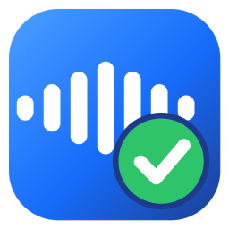
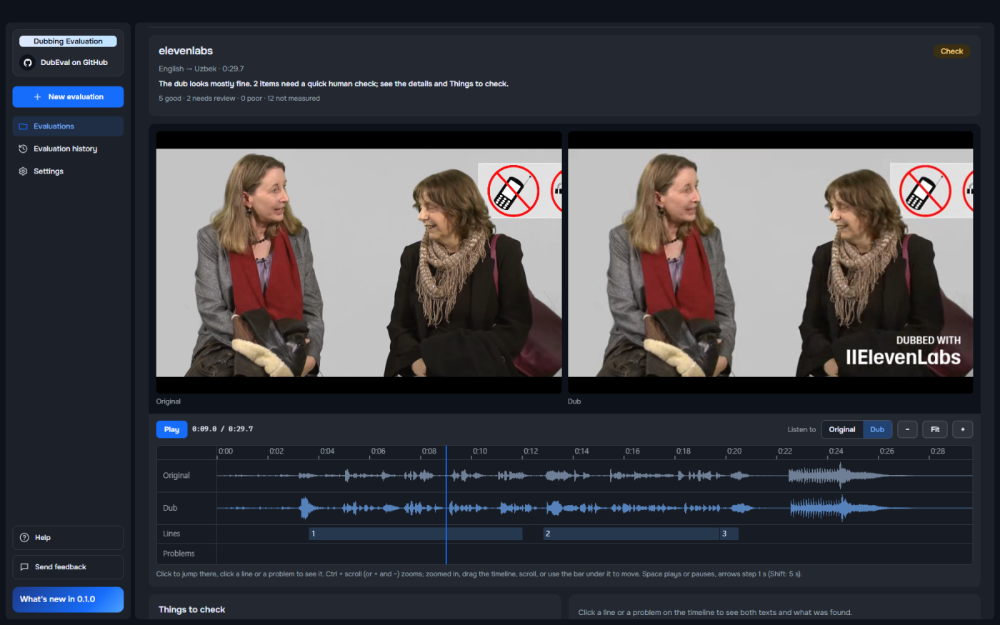
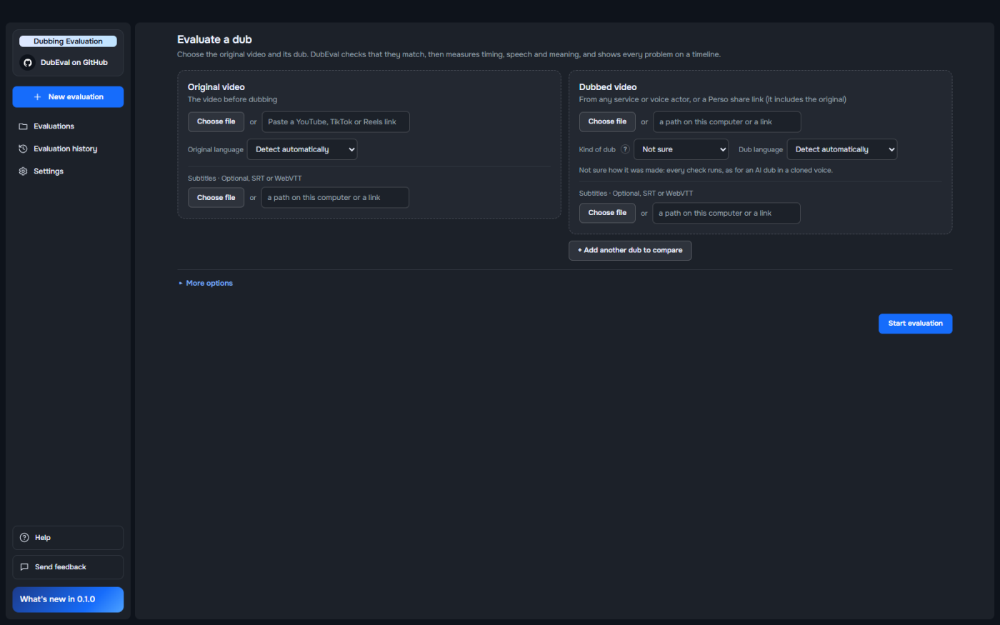
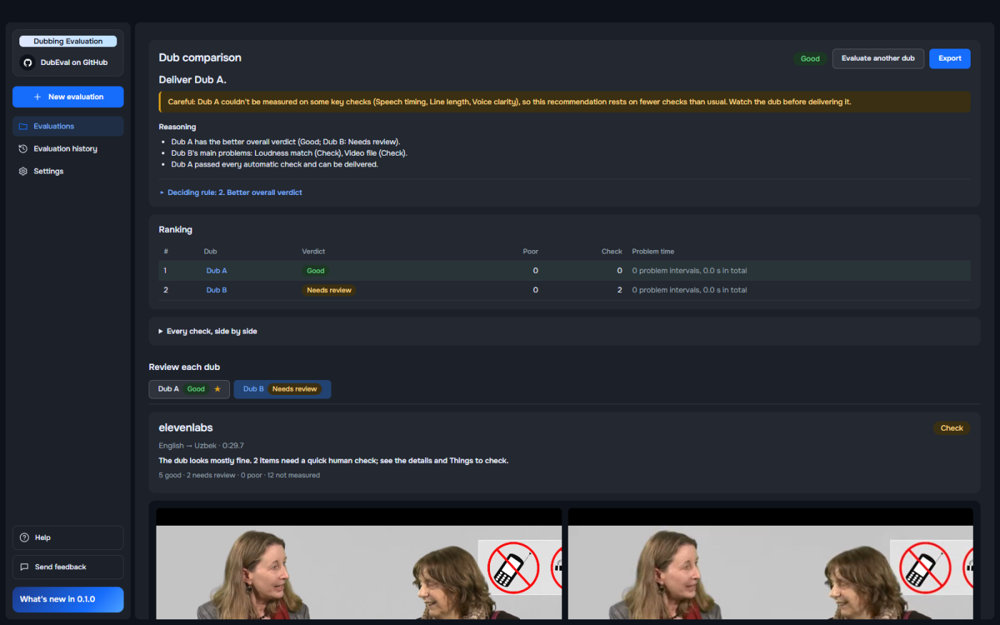
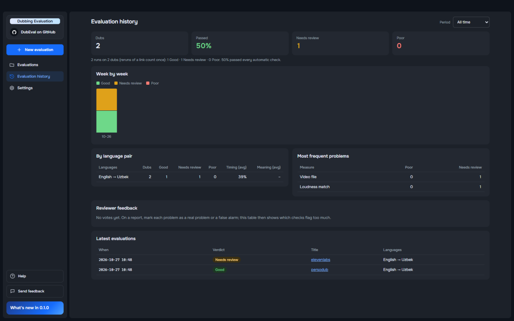
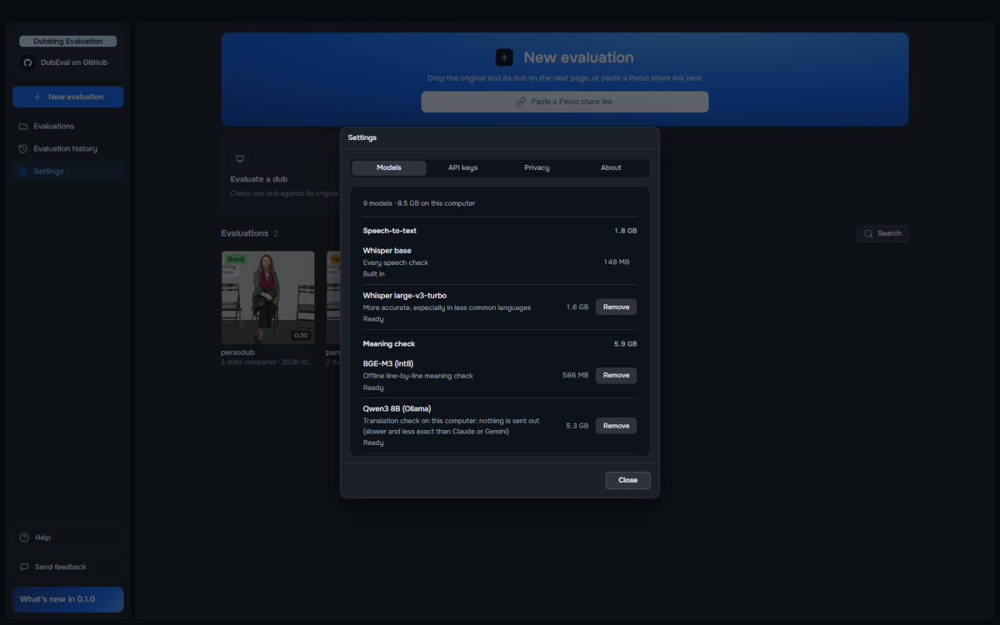

<p align="center">
  
</p>

<h1 align="center">DubEval</h1>

<p align="center"><strong>Know whether a dub is ready before you ship it.</strong></p>

<p align="center">
  <a href="#get-started">Download</a> ·
  <a href="#how-accurate-is-it">How accurate is it?</a> ·
  <a href="docs/usage.md">How to use it</a> ·
  <a href="docs/faq.md">FAQ</a> ·
  <a href="https://github.com/shox17/DubEval/issues">Report a problem</a>
</p>

<p align="center">
  <a href="LICENSE"></a>
  <a href="INSTALL.md"></a>
  <a href="https://github.com/shox17/DubEval/releases"></a>
  <a href="docs/privacy.md"></a>
</p>

<p align="center">
  <a href="https://github.com/shox17/DubEval/releases/latest/download/DubEval-Setup.exe"></a>
</p>

<p align="center">
  
</p>

<p align="center">Drop in the original and its dub. DubEval checks timing, speech, voice and meaning, puts every problem on a timeline,<br>and tells you which of several dubs to deliver, and why. Open-source, on your own computer, for dubs from any service.</p>

---

## What it does

<table>
<tr>
<td width="50%" valign="top">



### Evaluate a dub

Two files, two links or a Perso share link. Dubs from any service or from voice actors, in any language pair.

</td>
<td width="50%" valign="top">



### Compare dubs

Rank 2 to 8 dubs of the same video and get the one to deliver, with the reason. The rule is fixed and printed.

</td>
</tr>
<tr>
<td width="50%" valign="top">



### Track quality over time

Every evaluation is kept: the pass rate week by week, each language pair, and the problems that come up most.

</td>
<td width="50%" valign="top">



### Runs on your computer

Speech, voice and picture checks run here. Add a larger speech model or an offline meaning check in **Settings**.

</td>
</tr>
</table>

## Get started

1. [Download for Windows](https://github.com/shox17/DubEval/releases/latest/download/DubEval-Setup.exe).
2. Choose **New evaluation** and add the original and its dub, or paste a Perso share link.
3. Press **Start evaluation**.

Every check runs on this computer and needs no account. To check the translation too, add a Claude, Gemini or ChatGPT
key in **Settings → API keys**: only the two transcripts (text, never the video) are sent. To keep even that here,
download the local translation model in **Settings → Models**.

The installer is about 500 MB and DubEval takes 1.5 GB once installed; the speech, voice and picture models are inside,
so evaluations work offline. Optional models download from **Settings → Models**, each with its size.
[Full requirements](INSTALL.md)

<details>
<summary>Install notes</summary>

**Windows** — Run the downloaded `DubEval-Setup.exe`. It installs for your user account only, in about 2 minutes. It is not
code-signed yet, so SmartScreen shows "Windows protected your PC" the first time: click **More info**, check that the
app is `DubEval-Setup.exe`, then **Run anyway**. DubEval checks for updates when it starts and asks before
installing one. [Details](INSTALL.md#install-the-desktop-app-windows-beta)

**macOS and Linux** — No app yet. The command line and the web interface run from source:
[INSTALL.md](INSTALL.md#get-started-on-a-new-machine).

A walkthrough of every screen and check is in [docs/usage.md](docs/usage.md).

</details>

### Install with your AI assistant

Paste this into Claude Code, Codex or any coding agent.

```text
Install DubEval on this computer and check that it works.
Repository: https://github.com/shox17/DubEval

1. Check my OS, free disk and GPU. The desktop app needs 64-bit Windows 10 or 11 and
   2 GB of free disk. On macOS or Linux, follow INSTALL.md (from source) instead.
   If this computer falls short, say so and stop.
2. Install the latest release:
   https://github.com/shox17/DubEval/releases/latest
   On Windows, SmartScreen warns (not code-signed yet): More info, then Run anyway.
3. Open DubEval. Ask me if I want the translation check. If yes, open Settings, API keys,
   so I can paste a Claude, Gemini or ChatGPT key in myself. Never ask to see it.
4. Evaluate one short dub with me and explain the verdict and the things to check.
5. Report the version, where evaluations are saved, and how to reopen the app.
Finish the setup, not just a plan. Tell me any step you could not do.
```

## Why DubEval

- **Every problem has a time.** Long silences, loudness jumps, the wrong language, lines that run long or into the
  next one, mistranslations: each is a range on the timeline you can click and play.
- **A verdict you can check.** Good, Needs review or Poor, and every row says what was measured and how it is graded.
  No single black-box score.
- **Any dub, any service.** PersoDub, ElevenLabs, HeyGen, Rask AI or voice actors: it only needs the original and the
  dub. AI voice clones and human dubs are held to the right standard.
- **Pick the dub to deliver.** Compare up to 8 dubs of one video; the ranking rule is fixed, printed and repeatable.
- **Your videos stay yours.** Every audio and video check runs on this computer. Only the translation check, if you
  turn it on, sends text.

## How accurate is it?

DubEval measures; it doesn't replace watching the dub. Use the verdict to decide where to look first.

- **Any language pair works, without a promise.** The grades have been compared with a person's on 12 dubs (6 English
  → Korean, 4 English → Uzbek, 2 English → Spanish). DubEval agreed on 5 of the 6 Korean dubs, 1 of 4 Uzbek and 0 of 2
  Spanish. Treat languages other than Korean as a first look.
- **Speech recognition makes mistakes, and they spread.** Timing, clarity and the translation check read what
  Whisper heard; misheard words are marked as possible mishearings and never lower a grade.
- **Lip sync is shown for information only** in this beta.

More in the [FAQ](docs/faq.md#how-accurate-is-it).

## Details

| | |
|---|---|
| **Requirements** | 64-bit Windows 10 or 11 · 2 GB free disk · an NVIDIA GPU is optional (faster, and a more accurate speech model). [Install](INSTALL.md) |
| **Languages** | Any pair Whisper knows. Speaking pace is graded for Korean, English, Spanish, Japanese and Chinese; a check that can't work for a language says "not measured" with the reason. |
| **Translation check** | Claude, Gemini or ChatGPT with your own key, or a local model. Five scores per line: meaning, naturalness, context, terms, localization. [How it works](docs/metrics.md) |
| **Privacy** | Videos and audio never leave this computer; the translation check sends text only, and only if you turn it on. [What is sent](docs/privacy.md) |
| **Beyond the app** | Command line, batch checks of many links, a REST API and Docker. [Usage](docs/usage.md) |
| **How it works** | Motion and picture fingerprints, Whisper, DNSMOS, WeSpeaker, BGE-M3, an LLM judge. [Architecture](docs/architecture.md) · [Every check and its bands](docs/metrics.md) · [Roadmap](docs/roadmap.md) |
| **Build from source** | [INSTALL.md](INSTALL.md) · [Development](docs/development.md) · [Contributing](CONTRIBUTING.md) · [Security](SECURITY.md) |

## License

DubEval is free software, licensed under the **GNU Affero General Public License v3.0 or later**: see
[LICENSE](LICENSE). If you run a modified version for others over a network, you must offer them its source code.
Third-party components and models are listed, with their licenses, in [NOTICE](NOTICE).

"Perso" and "PersoDub" are trademarks of ESTsoft corp. DubEval's license covers its code; it grants no right to use
those names or logos.
